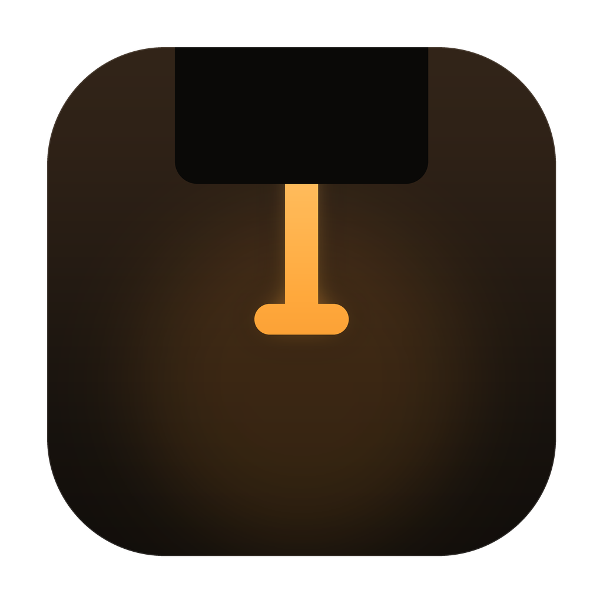

<p align="center">
  
</p>

<h1 align="center">Arrowslit</h1>

<p align="center">
  A quiet control surface for your MacBook's notch.
</p>

<p align="center">
  <a href="https://github.com/j4yop/arrowslit/releases/latest"></a>
  
  <a href="LICENSE"></a>
  
  
  
</p>

<p align="center">
  <b><a href="https://github.com/j4yop/arrowslit/releases/download/v0.11.0/Arrowslit-0.11.0.dmg">Download it here</a></b>
  &nbsp;·&nbsp; or with Homebrew: <code>brew install --cask j4yop/tap/arrowslit</code>
</p>

---

The notch on my MacBook just sits there doing nothing. I wanted it to be useful without getting in my way or making noise, so I made Arrowslit.

The name comes from the narrow opening in a fortress wall: the smallest aperture that still gives a defender a full view and full control. When something is going on, the notch shows it. When nothing is, it tucks back in and you forget it is there.

Here is what it shows:

* Whatever music is playing, with album art and animated bars tinted from the cover
* A full 390×218 player with artwork, lyrics, scrubber and back/pause/forward controls
* Timers, counting down right next to the camera
* A live wall clock in India Standard Time or local time
* A five-minute heads-up when your next meeting starts, with a Join button
* A drop target for files right on the closed notch

And when you click it, you get a little home base right under the notch:

* **Home** with the compact lyric-aware media card, the next calendar event, and quick 5m/10m/15m + Focus 25m actions
* **Now Playing**, a tall player with album art, lyrics, scrubber and back/pause/forward, plus the compact card on Home
* **Clipboard**, the last 20 things you copied. Click one to copy it again. Passwords from password managers are skipped and nothing is saved to disk
* **Notes**, a little scratchpad for phone numbers, ideas, whatever. Saves as you type
* **Mirror**, a quick look at your camera before you hop on a call, with a button to turn the camera off
* **Timer / Pomodoro / Stopwatch**, a shared iPhone-style clock panel with a sliding minute ruler, one haptic detent per minute, a 5-minute Pomodoro break, and a tenths-of-a-second stopwatch
* **Stats** with memory, CPU, disk and network tiles and animated bars that only sample while you look at them
* **Sports** with live Premier League, La Liga, Champions League, Serie A, Bundesliga and Ligue 1 scores, Following + Featured, and a compact notch score. Preview works without a key; live mode uses a BigBallsData free key
* **Files** with the full-width drop zone, pinned files that survive a quit, and AirDrop/open/reveal actions
* **Calendar** with a live month grid, busy-day dots, day-by-day event lists, start times, a five-minute heads-up, and Join buttons for Meet, Zoom, Teams and Webex
* **Reminders**, today's to-dos from Apple Reminders that you can tick off right in the notch
* **Keep Awake**, keeps your Mac from sleeping with one tap while still letting the screen dim

Drag files onto the notch and you can also AirDrop them straight from there. Files are references only; pin one to keep it across launches, while unpinned items clear when you quit. Your originals are never touched.

Everything else lives behind the grid button at the top right: the timer, stopwatch, calendar, today's reminders, the scratchpad, your camera mirror, system stats, Sports, and Keep Awake.

Next to Home at the top left sit up to three shortcuts of your own. They start as Files and Clipboard, and Files shows how many things are in your Tray. To change them, open the grid, click the pencil, and pick your favorites. Click **Done** when you are happy.

Arrowslit works on the built-in display and on external monitors. Choose Built-in, Main, Follow the pointer, a named display, or All displays in Settings › General › Display; screens without a camera housing get a virtual notch.

It does not need an account and does not track anything. Arrowslit asks GitHub when it starts and once a day after that whether a new version is out; you can turn that off in Settings. Lyrics are optional and off by default; if you turn them on, only the current song's title, artist, album and length are sent to lrclib.net and, when it has no answer, music.163.com. Everything else stays on your Mac. All of this is free and open source.

## Installing it

**The easy way, if you use [Homebrew](https://brew.sh):**

```bash
brew trust j4yop/tap && brew install --cask j4yop/tap/arrowslit
```

Homebrew 7 asks you to trust a third-party tap once. The cask clears the quarantine flag automatically, so you can open Arrowslit right away.

On Homebrew versions before 7, this is enough:

```bash
brew install --cask j4yop/tap/arrowslit
```

Otherwise, download it yourself:

Heads up: I haven't paid Apple for a developer account yet, so the first time you open the app your Mac will grumble about it. You only have to deal with this once and it takes about a minute.

1. Download **[Arrowslit-0.11.0.dmg](https://github.com/j4yop/arrowslit/releases/download/v0.11.0/Arrowslit-0.11.0.dmg)** and open it.
2. Drag **Arrowslit** into your **Applications** folder.
3. Go to Applications and double-click **Arrowslit**. Your Mac will say it could not open it. Just hit **Done**.
4. Open **System Settings**, go to **Privacy & Security** and scroll down a bit. You will see a line saying Arrowslit was blocked. Click **Open Anyway**, type your password (or use Touch ID) and click **Open Anyway** one more time.
5. Settings opens automatically. Pick your features, close the window, and Arrowslit stays live in your notch.

If you are comfortable with Terminal, you can skip steps 3 and 4. After dragging the app into Applications, run this and open the app like normal:

```bash
xattr -dr com.apple.quarantine "/Applications/Arrowslit.app"
open "/Applications/Arrowslit.app"
```

The download is a universal build that runs natively on Apple Silicon (M1/M2/M3/M4) and Intel Macs.

| Release Details | |
| :--- | :--- |
| **Version** | 0.11.0 (build 64) |
| **Direct Download** | [Arrowslit-0.11.0.dmg](https://github.com/j4yop/arrowslit/releases/download/v0.11.0/Arrowslit-0.11.0.dmg) |
| **SHA-256** | See `Arrowslit-0.11.0.dmg.sha256` in the release assets. |
| **Homebrew Cask** | [Casks/arrowslit.rb](https://github.com/j4yop/homebrew-tap/blob/main/Casks/arrowslit.rb) |

## Using it

| If you want to | Do this |
| :--- | :--- |
| Open the notch | Click the strip or hover the top center. Music/video opens the player; otherwise it opens Home |
| Open the full music player from Home | Click the expand button on the music card, or its artwork/title |
| Open anything else | Click the grid button at the top right |
| Change your top shortcuts | Open the grid, click the pencil, and select up to three favorites |
| Start a timer, Pomodoro or stopwatch | Open Timer/Stopwatch, slide the minute ruler, then press Start |
| Keep files for later, or AirDrop them | Drag them onto the notch and drop on **Tray** or **AirDrop** |
| Jot a quick note | Click Scratchpad; start typing immediately (saves as you type) |
| Copy past clipboard items | Click Clipboard, then click any card to copy it back |
| Close it | Click anywhere else, move your mouse down, or press Escape |
| Open from the menu bar | Click the slit icon in your menu bar |
| Open Settings | Click the gear icon at the top right, or choose Settings from the menu bar |
| Use the notch on the lock screen | Turn on Settings › Show on Lock Screen |
| Put the notch on another display | Settings › General › Display: Built-in, Main, Follow the pointer, All displays, or a named display |

## Things people ask

**I installed it and nothing's showing up.** That's on purpose. It stays hidden until there is something to show, like music or a timer. Move your mouse to the top center of the screen, or click the slit icon in your menu bar, and the workbench will slide open.

**My Mac doesn't have a notch.** It still works. You get a virtual notch at the top center of the screen that stays out of sight until you hover or click. It works the same way on external displays.

**My music isn't showing.** Play something and give it a second. Arrowslit talks to macOS media services through an isolated helper process. If Apple media services ever stall, Arrowslit stays fast and unaffected.

**How do I update it?** Homebrew users can run `brew upgrade --cask arrowslit`. The app itself checks GitHub when it starts and once a day after that. When a signed update is available, Settings › About offers **Install and Relaunch** and verifies the Ed25519 manifest, size and SHA-256 before swapping the app; otherwise it opens the DMG. Manual users can always download the latest DMG. You can turn the check off in Settings.

**Is it safe? Does it collect any data?** All the code is right here in this repository (it is free software, see [License](#license)). Arrowslit has no telemetry, tracking or user accounts. It checks GitHub when it starts and once a day for a new release unless you turn that off. Lyrics lookup is optional and off by default; when enabled, only the current song's title, artist, album and length are sent to lrclib.net and, when it has no answer, music.163.com. Sports is optional too: preview matches are local, and live mode sends only your BigBallsData key and competition queries to BigBallsData after you connect it in Settings. Everything else stays on your Mac. That warning during install only shows up because I haven't registered with Apple's paid developer program yet.

**Why is it asking for my camera or calendar?** Only if you use those bits. It asks for the camera when you open Mirror, calendar access when you click Connect on Calendar, and reminders access when you open Reminders. If you say no, those specific tabs stay disabled while the rest of Arrowslit keeps working.

**Does it keep what I copy?** Only while the app is running, and only the last 20 bits of plain text. It is kept in memory only and never written to disk. Anything a password manager marks as private or concealed is skipped. Don't want it? Turn off Clipboard in Settings and it stops watching immediately.

**How do I get rid of it?** Click the slit icon in the menu bar and pick **Quit Arrowslit**, then drag the app from Applications to the Trash. If you want to clear out saved preferences and notes too, delete `~/Library/Preferences/com.j4yop.arrowslit.plist` and `~/Library/Application Support/Arrowslit`.

## What you need

* macOS 14 (Sonoma) or newer
* Apple Silicon or Intel Mac
* Works with or without a physical display notch

## What is in 0.11.0

This is the AI Agents live-notch and AI Agents release:

* A full AI Agents page: Claude, Codex, OpenCode and GitHub Copilot readers, plan limits, API spend, models, projects, a stacked trend chart, a 13-week activity heatmap and Codex banked resets
* A live agent compact strip in the closed notch: every working provider's mark in its own tint, plus the running elapsed turn time
* Clicking the compact strip opens the AI Agents page
* One live activity at a time in the closed notch; the detached second-activity bubble is gone
* A new Notch settings tab with Arrowslit's 15 live feedback events, 7 closed-notch activities and 13 Dynamic Island feature switches
* Wired feedback: volume, brightness, microphone, input source, battery/charging, accessory connection, clipboard, downloads, AI agents, new tracks and timer completion
* Wired activities: timer, music, downloads, AI agents, calendar countdown and Keep Awake
* Calendar only takes the strip within 30 minutes of an event
* HUD transitions no longer leave the old compact reading ghosted underneath
* The call and microphone counter now uses white text, like the timer and stopwatch
* Unsupported AI Agents subsystems are visible but disabled in Settings rather than shipping fake toggles: the Notification Center mirror, OCR watch, media queue, companion and keyboard-light source

## What was in 0.10.1

This is the feel and finish pass against Notch Shell:

* The exact Notch Shell palette and type scale: orange, red, blue, green and yellow are the same system colours, with the same secondary-text and hairline values
* The persistent Home, Files and Clipboard shortcut strip in place of the old back-button header
* A 580 pt standard nook, matching Notch Shell's 560 pt body plus its 10 pt shoulders
* The launcher rebuilt around Notch Shell's five-column, two-row paged scroll, 16 pt tiles, 19 pt regular icons, 11.5 pt medium titles and real ⌃⌥ shortcut labels
* Click-to-open or hover-to-open, with a configurable 0.1–0.5 second hover delay
* Notch Shell's 0.9 press spring, 0.7 press opacity, 0.15 hover fade and alignment haptics
* Clipboard now opens to its cards, with search and clear on the right and the search field growing below only when needed
* Tray and Clipboard cards use Notch Shell's 48 pt file icons, 150 pt clipboard cards and hover pin/remove controls
* Calendar, Timer and Player sizing corrected: 580×178 nook panels, a 390×188 no-lyrics player and a conditional lyrics row
* Small and Medium sizes scale the header, launcher, Home, Tray, Clipboard and Calendar instead of clipping
* Pitch black now removes the outline and shadow across every surface, so the shape fuses into the notch

## What was in 0.10.0

This is the Notch Shell parity release. It is a broad shell port, not only a feature drop:

* Notch Shell's appearance engine: size, width, thickness, theme, glass tint, pitch black, standard/elongated layout and reset
* Hidden-at-rest notch with a hover peek, configurable hover delay, idle pill, click-to-open and collapse-on-leave
* 274×32 compact ears, concave shoulders, the 30 pt expanded radius and 16 pt alert radius
* Home at 560×178 and the elongated 1240×178 row for Home, Tray and Clipboard
* Multi-display support: Built-in, Main, Follow the pointer, named display and All displays, with one active panel and mirror panels
* Virtual notch on external displays without a camera housing
* Buttons to allow, deny or ask on behalf of Claude Code, Codex, Copilot CLI, Antigravity, Cursor and OpenCode
* Calls and microphone detection with mute, a call panel and app-specific hang-up routes
* Download progress, finished-download alerts, Show in Finder and Stop, including a Chrome/Firefox partial-file fallback
* Media source switching, app filtering, scrolling titles and paused-media linger
* Clipboard search, pinned clips and Return-to-copy
* Rich Notes, inline to-dos, the Shortcuts runner and Reminders
* Tray links, drop preview, compact Stats and the detached second-activity bubble
* Signed in-place updates with an Ed25519 manifest and a stable self-signed permission identity
* Five-tab native Settings shell with labelled controls, 4 pt hit slop, spoken timer values and accessibility actions

## What is in 0.9.2

* Sports tab with live Premier League, La Liga, Champions League, Serie A, Bundesliga and Ligue 1 scores
* BigBallsData Free adapter with a Keychain-stored key and a 250-request/day quota display
* Sports starts in Preview with sample matches, so the nook works before you connect a key
* Following + Featured ranking: pin a match, follow teams, or filter by competition
* 32px notch score for the pinned or first live match, with the football clock in the Sports pane and detail
* Goal popup with the scoring team, new score, minute, a spring animation and a haptic; only while Arrowslit is running
* Inline match detail with football key events
* Quota-aware refresh at 30/60/120 seconds; polling slows down when requests run low
* Menu bar accessory with notch-fused compact strip
* 560×178 pt expanded workbench with smooth spring transitions
* Shared Timer/Pomodoro/Stopwatch panel with a sliding minute ruler and per-minute haptic detents
* Precision stopwatch with tenths-of-a-second readout
* Narrow 360×124 running timer/stopwatch compact strip with back, pause/resume and close
* Music/video opens the 390×218 player by default; otherwise the notch opens Home
* A launch and daily update check with a one-click Download & Open button in the notch and Settings
* Update checks use the GitHub releases redirect first, so they do not depend on the anonymous API quota
* Full 390×218 Now Playing player with lyrics, plus the 306×146 Apple Music-style compact strip on Home
* The Home compact card has an expand button (and clickable artwork/title) that opens the full player
* Liquid animations and haptic feedback toggles in Settings
* Optional lock-screen notch for a running timer, media or charging
* Charging, low-battery, headphone and volume/brightness alerts, each with its own toggle
* System alerts appear inside the compact notch as a live icon-and-level HUD, matching the Notch Shell motion
* Update checks run on launch and notify the notch once per new release with a **Download & Open** action
* Volume alerts also work on Bluetooth headphones that expose volume on channel 1/2 instead of the main element
* Charging and low-battery icons pulse gently; volume and brightness levels animate smoothly
* Optional timed lyrics, off by default: lrclib.net first, then a timed fallback when lrclib is down
* Lyrics retry automatically while a song keeps playing, and the player says when lyrics are unavailable
* Next calendar event, five-minute heads-up and Join buttons for Meet, Zoom, Teams and Webex
* Today's to-dos from Reminders
* File tray with drag-and-drop shelf and 1-click AirDrop
* In-memory clipboard history that skips password managers
* Persistent scratchpad saved locally as you type
* Camera mirror preview that shuts off when closed
* Mach CPU and Darwin memory gauges with zero idle draw
* Keep Awake system sleep prevention
* Customizable shortcut slots beside Home
* One-alert-at-a-time notch notifications with expiry, urgency and dismissal

## Want to build it yourself?

Requires Swift 6 and Xcode 16 or newer.

```bash
# Run test suite
swift test

# Build application bundle
./Scripts/build-app.sh
open "build/Arrowslit.app"

# Build universal release DMG
UNIVERSAL=1 CONFIG=release ./Scripts/build-app.sh
SKIP_BUILD=1 ./Scripts/make-dmg.sh
```

## License

Arrowslit is free software, © 2026 Jay Gopal and contributors. You can use it, share it, and change it under the [GNU General Public License, version 3](LICENSE) or (at your choice) any later version.
