<p align="center">
  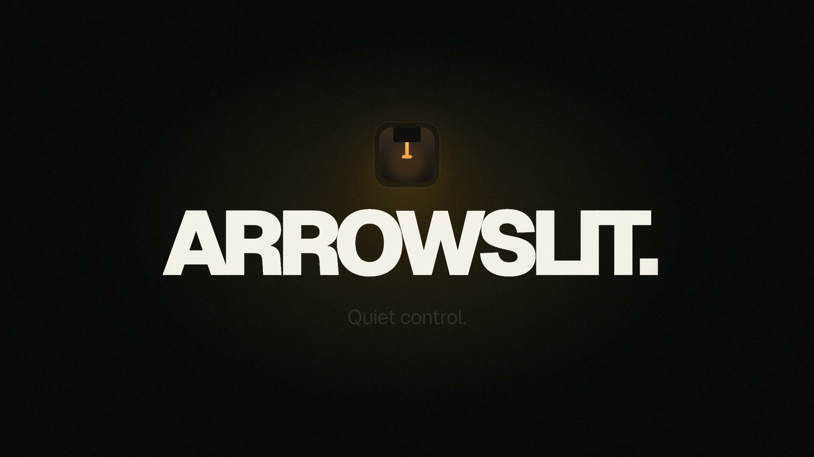
</p>

<h1 align="center">Arrowslit</h1>

<p align="center">
  <b>Quiet control for your MacBook notch.</b><br>
  AI agent spend, instant approvals, focus timers, clipboard, files, media, and system stats. All right at the edge.
</p>

<p align="center">
  <a href="https://github.com/j4yop/arrowslit/releases/latest"></a>
  
  <a href="LICENSE"></a>
  
  
  
</p>

<p align="center">
  <a href="https://github.com/j4yop/arrowslit/releases/download/v0.12.14/Arrowslit-0.12.14.dmg"><b>Download Arrowslit 0.12.14 DMG</b></a>
  &nbsp;·&nbsp;
  or with Homebrew 7: <code>brew trust j4yop/tap && brew install --cask j4yop/tap/arrowslit</code>
</p>

<p align="center">
  New here? <a href="Docs/User-Guide.md"><b>Read the User Guide</b></a> — install, every tool, settings, privacy and fixes in one page.
</p>

---

<p align="center">
  <a href="Docs/Media/Arrowslit-Launch-48s.mp4">
    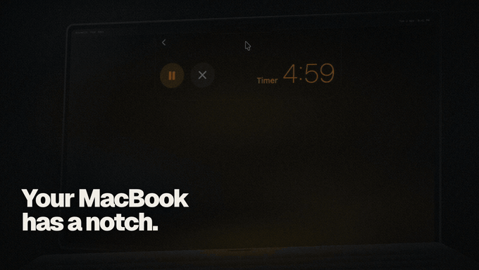
  </a>
</p>

---

## Installation

### Method 1: Homebrew 7 (Recommended)

```bash
brew trust j4yop/tap && brew install --cask j4yop/tap/arrowslit
```

Homebrew 7 prompts you once to trust third-party taps. The cask clears the macOS quarantine flag automatically so Arrowslit opens immediately. On Homebrew 6 or earlier, use the DMG below — the tap uses Homebrew 7’s trust and postflight APIs.

---

### Method 2: Direct Download DMG

Requires **macOS 14 (Sonoma) or later**. The build is signed with a local certificate but is **not notarized by Apple**, so macOS blocks the first launch. That is expected — it is not a corrupt download.

1. Download **[Arrowslit-0.12.14.dmg](https://github.com/j4yop/arrowslit/releases/download/v0.12.14/Arrowslit-0.12.14.dmg)** (and the matching `.sha256` if you want to verify it).
2. Open the disk image and drag **Arrowslit** into your **Applications** folder.
3. Open Applications and double-click **Arrowslit**. macOS will say it cannot verify the app. Click **Done**.
4. Do one of these:
   - **System Settings › Privacy & Security**, scroll to the **Security** section, click **Open Anyway** next to Arrowslit, and confirm. (Some macOS 26/27 builds do not show this button for unnotarized apps.)
   - **Terminal** — works on every macOS version:

     ```bash
     xattr -dr com.apple.quarantine "/Applications/Arrowslit.app"
     open "/Applications/Arrowslit.app"
     ```

5. Arrowslit launches and immediately docks into your notch.

If macOS says **“Arrowslit is damaged and can’t be opened”**, that is the same quarantine block, not a damaged file. Run the Terminal commands above. To verify the download first:

```bash
shasum -a 256 -c Arrowslit-0.12.14.dmg.sha256
```

The `.sha256` file must be in the same folder as the DMG. The file lists only `Arrowslit-0.12.14.dmg`, so the command works on your machine.

### Release Metadata

| Detail | Value |
| :--- | :--- |
| **Current Release** | 0.12.14 (build 110) |
| **Release Type** | Stable |
| **Direct Download** | [Arrowslit-0.12.14.dmg](https://github.com/j4yop/arrowslit/releases/download/v0.12.14/Arrowslit-0.12.14.dmg) |
| **Architecture** | Universal Binary (Apple Silicon M1/M2/M3/M4 + Intel Core) |
| **SHA-256 Checksum** | `89eac0a500b79ed39df6fbc76f7650f9fb9163ed08c70783a48454c419bac09c` |
| **License** | GNU General Public License v3.0 or later |

---

## Why Arrowslit?

The notch on your MacBook usually sits empty. Most of the day it does nothing at all.

Arrowslit gives that dead space a real job. The name comes from medieval fortress architecture: the narrow opening in a stone wall that gives a defender a wide field of vision and complete control while revealing almost nothing.

When something needs your attention, the notch smoothly opens. When everything is quiet, it tucks back into the bezel and gets completely out of your way.

* **No cloud account, no sign-in, and zero analytics.**
* **Local memory only:** Clipboard history and scratchpad stay on your Mac.
* **Near-zero idle CPU:** Gauges and meters sleep when the notch is closed.
* **Native Swift & AppKit:** Built for macOS 14 Sonoma and macOS 15 Sequoia.

---

## Everything at the Edge

<p align="center">
  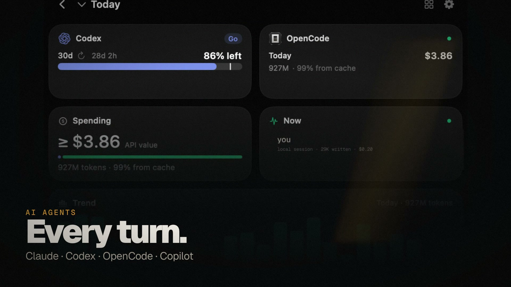
</p>

### AI Agents & Live Token Spend
Track Claude, Codex, OpenCode, and GitHub Copilot live from your notch. Watch active turns, token velocity, cache efficiency, and exact API dollar spend in real time without opening a browser or logging into another billing portal.

---

<p align="center">
  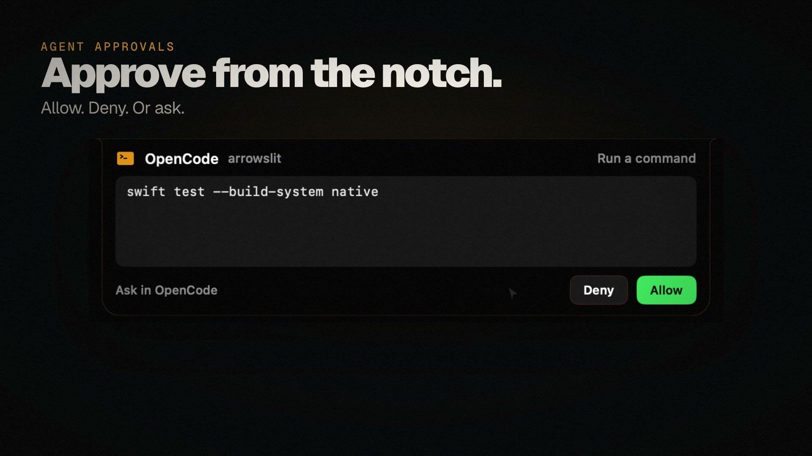
</p>

### One-Click Agent Approvals
When a local agent asks to execute a shell command, read files, or run tests, the approval request surfaces right in your notch. Review the command line and click **Allow**, **Deny**, or **Ask in CLI** with zero window switching.

---

<p align="center">
  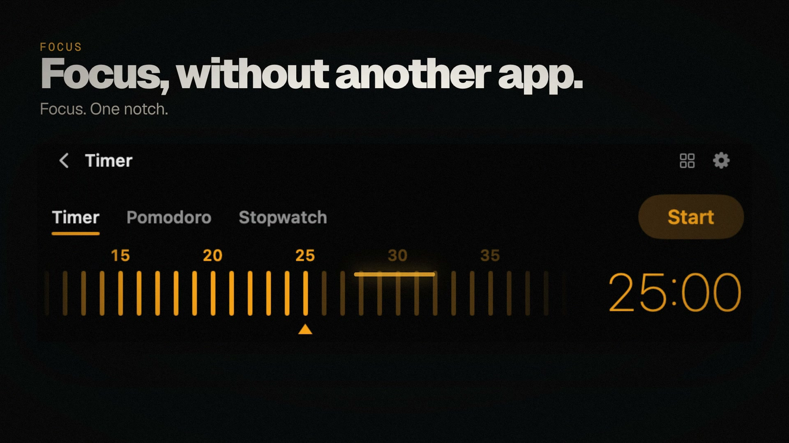
</p>

### Focus, Pomodoro & Timers
A shared clock panel with an iPhone-style sliding minute ruler, per-minute haptic feedback, a 5-minute Pomodoro break button, and a tenths-of-a-second stopwatch.

<p align="center">
  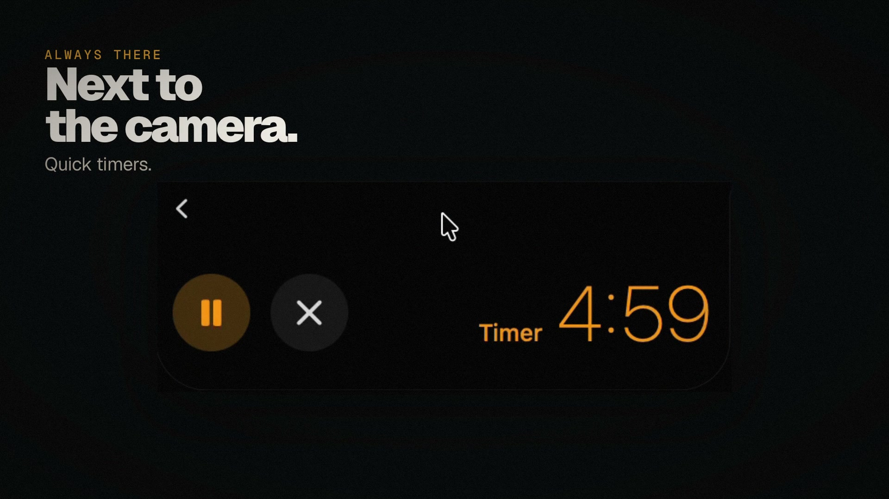
</p>

When you collapse the notch, your running timer stays pinned right next to the physical camera housing with pause and dismiss controls.

---

<p align="center">
  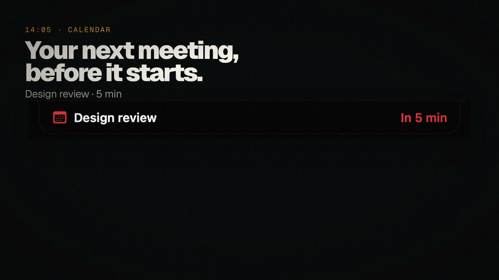
</p>

### Calendar & 5-Minute Meeting Heads-Up
Glance at your day with an interactive month grid and day-by-day event agenda. Five minutes before your next meeting begins, Arrowslit slides out a quiet heads-up with a direct **Join** button for Google Meet, Zoom, Microsoft Teams, and Webex.

---

<p align="center">
  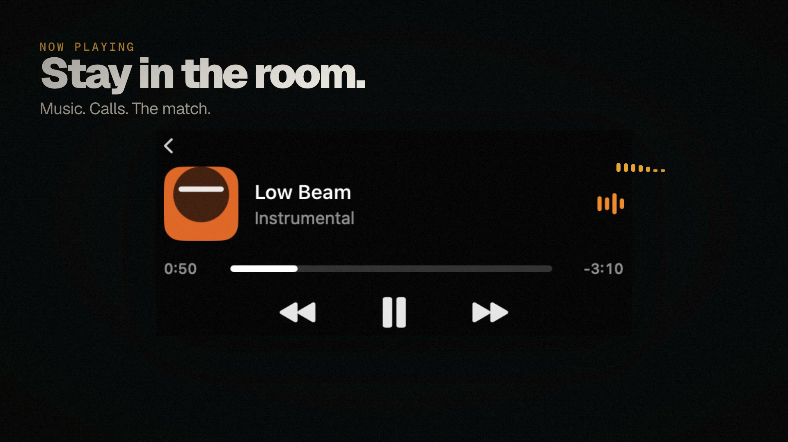
</p>

### Now Playing & Audio
A full player featuring album artwork, synchronized lyrics, a scrubbable timeline, and back/pause/forward controls. Arrowslit communicates with macOS audio through an isolated helper process, keeping your interface butter-smooth even if system audio services stall.

---

<p align="center">
  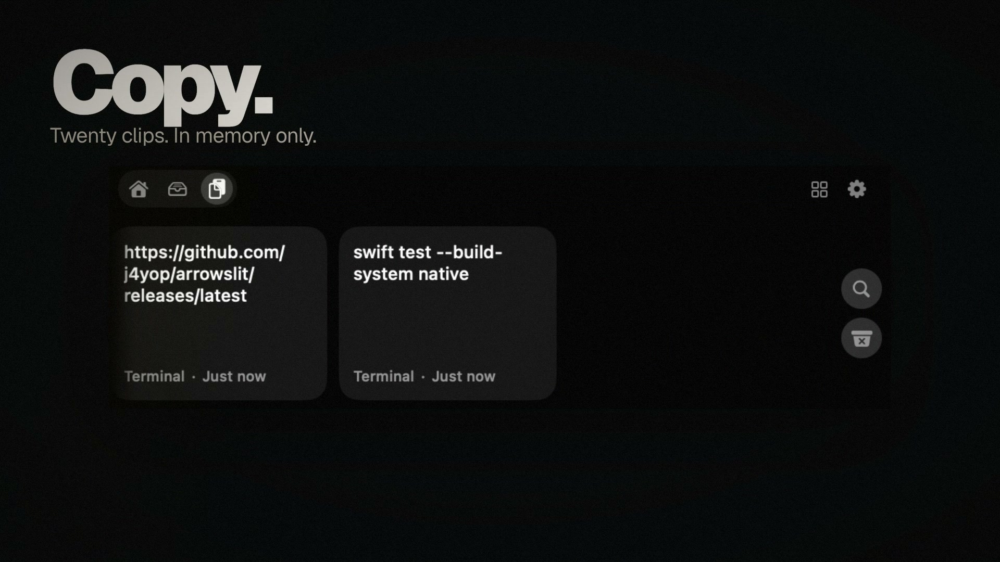
</p>

### Private Clipboard History
Keeps your last 20 plain-text clips accessible with one click. Everything is held strictly in volatile RAM and is never written to disk. Passwords and concealed items from 1Password, Bitwarden, and Apple Keychain are automatically ignored.

---

<p align="center">
  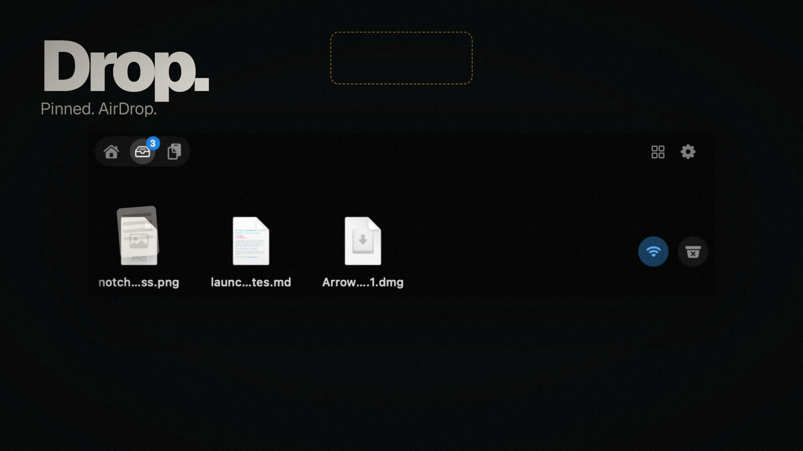
</p>

### File Drop Zone & Instant AirDrop
Drag any file from Finder onto the closed notch. Drop it on your Tray shelf to reference it later, or drop it on AirDrop to broadcast it instantly to nearby Macs and iPhones. Pinned files survive app restarts; unpinned references clear automatically on quit.

---

<p align="center">
  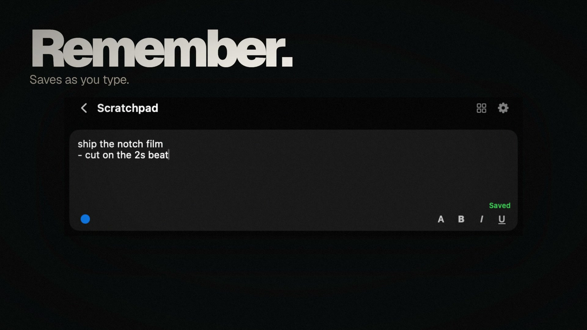
</p>

### Quick Scratchpad
A zero-friction notepad for phone numbers, code snippets, or thoughts. Formats with bold, italic, and underline, and saves locally as you type.

---

<p align="center">
  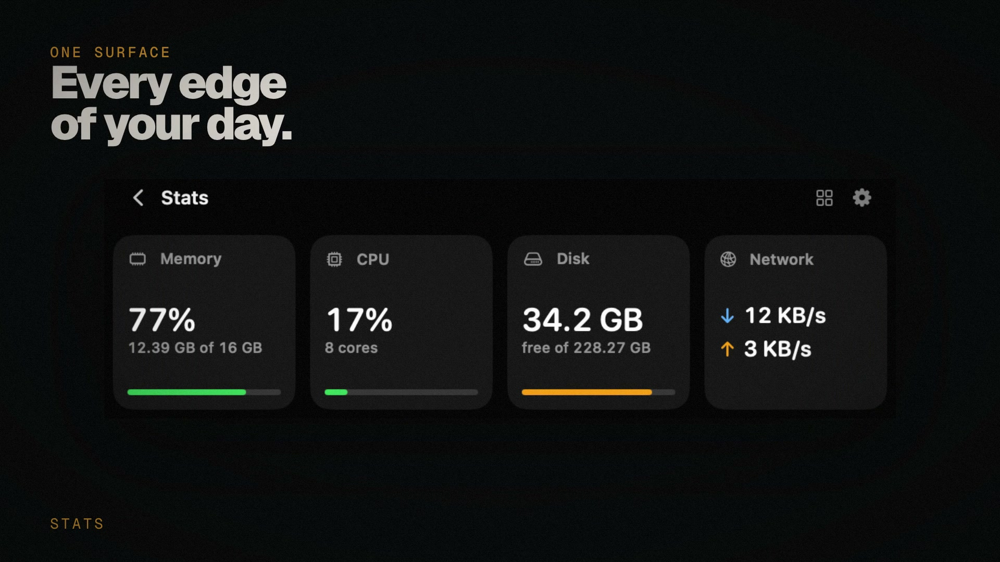
</p>

### Live System Stats
Glanceable real-time monitors for Memory pressure, CPU load across all cores, Disk space, and live Network bandwidth. Sensors only sample while the panel is visible, keeping idle battery draw at zero.

---

<p align="center">
  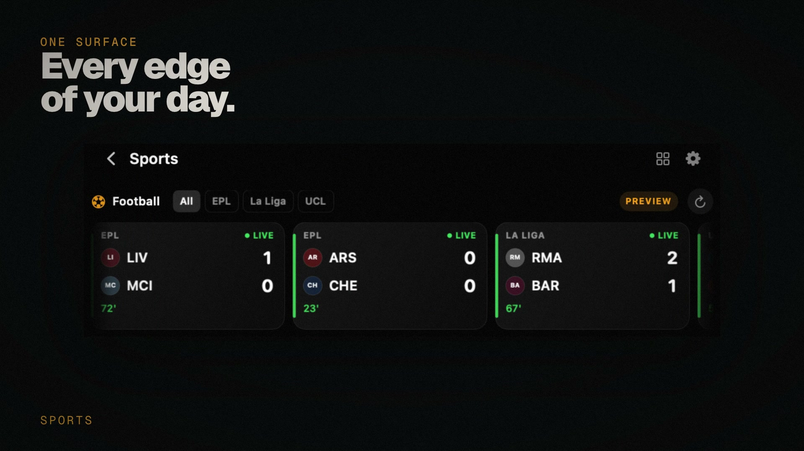
</p>

### Live Sports & Football
Follow live scores from the Premier League, La Liga, UEFA Champions League, Serie A, Bundesliga, and Ligue 1. Pin your favorite matches or teams for live goal alerts and compact notch scores.

---

<p align="center">
  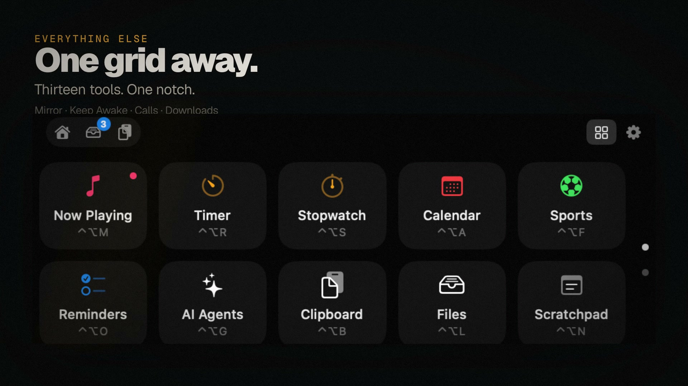
</p>

### Thirteen Tools. One Grid Away.
Click the grid icon at the top right to access any utility instantly, with customizable shortcut keys:

| Shortcut | Tool | Description |
| :--- | :--- | :--- |
| `^⌥M` | **Now Playing** | Tall music player with live lyrics and scrubber |
| `^⌥R` | **Timer** | Sliding minute ruler with Pomodoro quick actions |
| `^⌥S` | **Stopwatch** | Tenths-of-a-second precision stopwatch |
| `^⌥A` | **Calendar** | Day agenda, month grid, and meeting links |
| `^⌥F` | **Sports** | Premier League, La Liga, and Champions League live |
| `^⌥O` | **Reminders** | Today's Apple Reminders checklist |
| `^⌥G` | **AI Agents** | Token telemetry, spend, and prompt activity |
| `^⌥B` | **Clipboard** | Configurable in-memory clipboard history |
| `^⌥L` | **Files** | File shelf with drag-and-drop and AirDrop |
| `^⌥N` | **Scratchpad** | Local notes with instant autosave |
| `^⌥W` | **Camera Mirror** | Camera check before calls (turns sensor off when closed) |
| `^⌥P` | **Stats** | Darwin memory, Mach CPU, disk, and network |
| `^⌥Z` | **Keep Awake** | Prevents system sleep while allowing screen dimming |

---

<p align="center">
  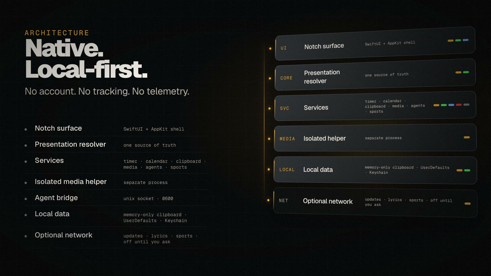
</p>

---

<p align="center">
  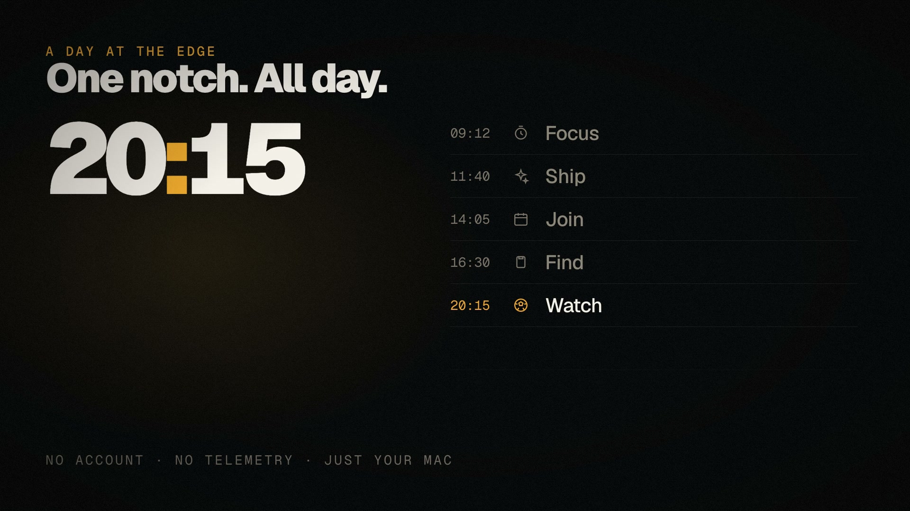
</p>

---

## Quick Interaction Reference

| Action | How to do it |
| :--- | :--- |
| **Open Notch** | Hover over the top center of your screen, or click the slit icon in your menu bar |
| **Open Full Music Player** | Click the expand arrow on the Home music card, or click the album artwork |
| **Open Launcher Grid** | Click the 2x2 grid icon in the top right corner of the notch |
| **Customize Top Shortcuts** | Open the launcher grid, hold any tile, or use **Settings › Home › Launcher shortcuts**, and pick your top three tools |
| **Drop Files or AirDrop** | Drag any file from Finder onto the notch and release over **Tray** or **AirDrop** |
| **Collapse Notch** | Move your pointer away, click outside the panel, or press **Escape** |
| **External Displays** | Select your preferred monitor in **Settings › General › Display** |
| **Lock Screen Notch** | Toggle **Show on Lock Screen** in Settings to keep timers and media visible |

---

## Things People Ask

### I installed it and nothing is showing up.
**Answer:** That is intentional. Arrowslit stays completely hidden at rest until there is active information to display (such as music playing or a running timer). Move your cursor to the top center of your display or click the small slit icon in your macOS menu bar to open the workbench immediately.

---

### My Mac does not have a display notch.
**Answer:** Arrowslit works identically on MacBooks without a physical notch, as well as on external monitors, Mac minis, Mac Studios, and iMacs. The app draws an unobtrusive virtual notch at the top center of the screen that expands smoothly on hover or click.

---

### My music is not appearing in the notch.
**Answer:** Play a track in Apple Music, Spotify, or your browser and allow a second for media notification. Arrowslit communicates with macOS media controls through an isolated helper process. If Apple media services ever hitch, Arrowslit stays fast, stable, and unaffected.

---

### How do I update Arrowslit?
**Answer:** Homebrew users can run `brew upgrade --cask arrowslit`. The app also checks GitHub on launch and once per day. When a signed release is published, **Settings › About** offers an **Install and Relaunch** button that cryptographically verifies the Ed25519 manifest, package size, and SHA-256 hash before updating.

---

### Is Arrowslit safe? Does it collect any data?
**Answer:** Arrowslit is 100% free and open-source software under GPL-3.0. It contains zero tracking code, zero analytics, zero telemetric beacons, and requires no user account. Update checks query GitHub releases anonymously. Lyrics lookups are strictly optional and disabled by default. Sports preview matches are generated locally; live mode queries BigBallsData only after you provide your own key in Settings. Everything else remains strictly on your local Mac.

---

### Why does it ask for camera, calendar, or reminders permissions?
**Answer:** Only when you actively trigger those specific tools. macOS prompts for camera permission when you open Mirror, calendar permission when you click Connect on Calendar, and reminders permission when opening Reminders. If you decline, those specific panels stay disabled while the rest of Arrowslit functions normally.

---

### Does Arrowslit store what I copy?
**Answer:** Only while the application is active, and up to the history length you choose in Settings (20 by default). History is stored exclusively in volatile system RAM and is never written to disk or sent to any server. Content flagged as sensitive or concealed by password managers is skipped by default, and you can change that or clear the history in Settings.

---

### How do I uninstall Arrowslit completely?
**Answer:** Click the slit icon in your macOS menu bar and choose **Quit Arrowslit**. Then drag Arrowslit from your **Applications** folder to the Trash. If you wish to delete saved local configuration files and notes, remove `~/Library/Preferences/com.j4yop.arrowslit.plist` and `~/Library/Application Support/Arrowslit`.

---

## Documentation

- **[User Guide](Docs/User-Guide.md)** — install, the notch, every tool, settings, privacy and troubleshooting.
- [Agent approval security review](Docs/Agent-Approval-Security.md) — the trust boundary behind Allow, Deny and Ask.
- [Architecture](ARCHITECTURE.md) — how the app is put together.

---

## Build from Source

Building Arrowslit locally requires macOS 14+, Xcode 16+, and Swift 6:

```bash
# Clone the repository
git clone https://github.com/j4yop/arrowslit.git
cd arrowslit

# Run the test suite
swift test

# Build debug application bundle
./Scripts/build-app.sh
open "build/Arrowslit.app"

# Build universal release bundle and DMG
UNIVERSAL=1 CONFIG=release ./Scripts/build-app.sh
SKIP_BUILD=1 ./Scripts/make-dmg.sh
```

---

## License

Arrowslit is free software licensed under the [GNU General Public License v3.0](LICENSE).
