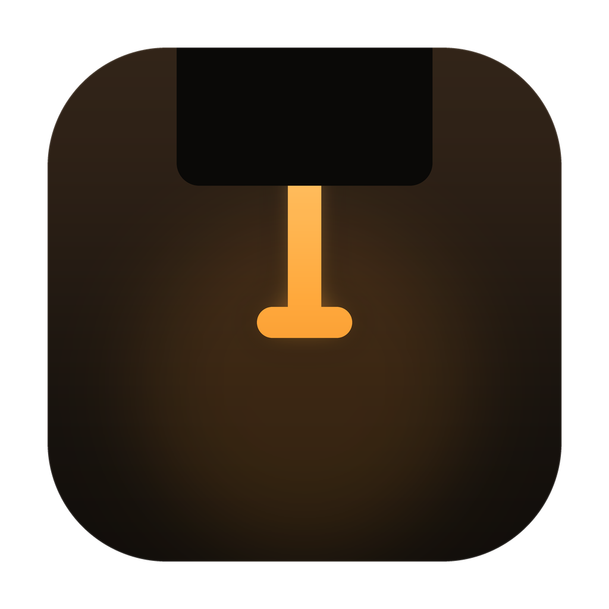

<p align="center">
  
</p>

<h1 align="center">Arrowslit</h1>

<p align="center">
  A quiet control surface for your MacBook's notch.
</p>

<p align="center">
  <a href="https://github.com/j4yop/arrowslit/releases/latest"></a>
  
  <a href="LICENSE"></a>
  
  
  
</p>

<p align="center">
  <b><a href="https://github.com/j4yop/arrowslit/releases/download/v0.4.4/Arrowslit-0.4.4.dmg">Download it here</a></b>
  &nbsp;·&nbsp; or with Homebrew: <code>brew install --cask j4yop/tap/arrowslit</code>
</p>

---

The notch on my MacBook just sits there doing nothing. I wanted it to be useful without getting in my way or making noise, so I made Arrowslit.

The name comes from the narrow opening in a fortress wall: the smallest aperture that still gives a defender a full view and full control. When something is going on, the notch shows it. When nothing is, it tucks back in and you forget it is there.

Here is what it shows:

* Whatever music is playing, with album art and animated bars tinted from the cover
* A full 390×218 player with artwork, lyrics, scrubber and back/pause/forward controls
* Timers, counting down right next to the camera
* A live wall clock in India Standard Time or local time
* A five-minute heads-up when your next meeting starts, with a Join button
* A drop target for files right on the closed notch

And when you click it, you get a little home base right under the notch:

* **Home** with your music, next event, quick timer presets, a 25/5 focus session, and live CPU/memory stats
* **Now Playing**, a tall player with album art, lyrics, scrubber and back/pause/forward, plus the nudge card on Home
* **Files Tray**, a handy spot to drop files you will need again in a minute. Drag files onto the notch to put them there
* **Clipboard**, the last 20 things you copied. Click one to copy it again. Passwords from password managers are skipped and nothing is saved to disk
* **Notes**, a little scratchpad for phone numbers, ideas, whatever. Saves as you type
* **Mirror**, a quick look at your camera before you hop on a call, with a button to turn the camera off
* **Timer**, with quick presets (5m, 10m, 25m, 50m), a 25-minute Focus session, a separate break timer, and a tenths-of-a-second stopwatch
* **Calendar**, your next event with start times, a five-minute heads-up, and a Join button for Meet, Zoom, Teams and Webex
* **Reminders**, today's to-dos from Apple Reminders that you can tick off right in the notch
* **System Stats**, CPU core usage and memory pressure that only sample while you look at them, keeping idle battery draw at zero
* **Keep Awake**, keeps your Mac from sleeping with one tap while still letting the screen dim

Drag files onto the notch and you can also AirDrop them straight from there. Tray is a scratch space: it holds temporary references and clears when you quit Arrowslit, without ever touching your original files.

Everything else lives behind the grid button at the top right: the timer, stopwatch, calendar, today's reminders, the scratchpad, your camera mirror, system stats, and Keep Awake.

Next to Home at the top left sit up to three shortcuts of your own. They start as Files and Clipboard, and Files shows how many things are in your Tray. To change them, open the grid, click the pencil, and pick your favorites. Click **Done** when you are happy.

Arrowslit lives on your MacBook's built-in display for now. Multi-display support is planned.

It does not need an account and does not track anything. Arrowslit asks GitHub once a day whether a new version is out; you can turn that off in Settings. Lyrics are optional and off by default; if you turn them on, only the current song's title, artist, album and length are sent to lrclib.net. Everything else stays on your Mac. All of this is free and open source.

## Installing it

**The easy way, if you use [Homebrew](https://brew.sh):**

```bash
brew trust j4yop/tap && brew install --cask j4yop/tap/arrowslit
```

Homebrew 7 asks you to trust a third-party tap once. The cask clears the quarantine flag automatically, so you can open Arrowslit right away.

On Homebrew versions before 7, this is enough:

```bash
brew install --cask j4yop/tap/arrowslit
```

Otherwise, download it yourself:

Heads up: I haven't paid Apple for a developer account yet, so the first time you open the app your Mac will grumble about it. You only have to deal with this once and it takes about a minute.

1. Download **[Arrowslit-0.4.4.dmg](https://github.com/j4yop/arrowslit/releases/download/v0.4.4/Arrowslit-0.4.4.dmg)** and open it.
2. Drag **Arrowslit** into your **Applications** folder.
3. Go to Applications and double-click **Arrowslit**. Your Mac will say it could not open it. Just hit **Done**.
4. Open **System Settings**, go to **Privacy & Security** and scroll down a bit. You will see a line saying Arrowslit was blocked. Click **Open Anyway**, type your password (or use Touch ID) and click **Open Anyway** one more time.
5. Settings opens automatically. Pick your features, close the window, and Arrowslit stays live in your notch.

If you are comfortable with Terminal, you can skip steps 3 and 4. After dragging the app into Applications, run this and open the app like normal:

```bash
xattr -dr com.apple.quarantine "/Applications/Arrowslit.app"
open "/Applications/Arrowslit.app"
```

The download is a universal build that runs natively on Apple Silicon (M1/M2/M3/M4) and Intel Macs.

| Release Details | |
| :--- | :--- |
| **Version** | 0.4.4 (build 15) |
| **Direct Download** | [Arrowslit-0.4.4.dmg](https://github.com/j4yop/arrowslit/releases/download/v0.4.4/Arrowslit-0.4.4.dmg) |
| **SHA-256** | `PENDING_RELEASE_SHA` |
| **Homebrew Cask** | [Casks/arrowslit.rb](https://github.com/j4yop/homebrew-tap/blob/main/Casks/arrowslit.rb) |

## Using it

| If you want to | Do this |
| :--- | :--- |
| Open the notch | Click the strip or hover the top center. Music/video opens the player; otherwise it opens Home |
| Open anything else | Click the grid button at the top right |
| Change your top shortcuts | Open the grid, click the pencil, and select up to three favorites |
| Start a timer, focus session or stopwatch | Tap a preset button or hit Focus on Home |
| Keep files for later, or AirDrop them | Drag them onto the notch and drop on **Tray** or **AirDrop** |
| Jot a quick note | Click Scratchpad; start typing immediately (saves as you type) |
| Copy past clipboard items | Click Clipboard, then click any card to copy it back |
| Close it | Click anywhere else, move your mouse down, or press Escape |
| Open from the menu bar | Click the slit icon in your menu bar |
| Open Settings | Click the gear icon at the top right, or choose Settings from the menu bar |

## Things people ask

**I installed it and nothing's showing up.** That's on purpose. It stays hidden until there is something to show, like music or a timer. Move your mouse to the top center of the screen, or click the slit icon in your menu bar, and the workbench will slide open.

**My Mac doesn't have a notch.** It still works. You get a virtual notch at the top center of the screen that stays out of sight until you hover or click. It works the same way on external displays.

**My music isn't showing.** Play something and give it a second. Arrowslit talks to macOS media services through an isolated helper process. If Apple media services ever stall, Arrowslit stays fast and unaffected.

**How do I update it?** Homebrew users can run `brew upgrade --cask arrowslit`. The app itself checks GitHub once a day and shows **Download & Open** in Settings › Updates; after the DMG opens, drag Arrowslit into Applications. Manual users can always download the latest DMG. You can turn the check off in Settings.

**Is it safe? Does it collect any data?** All the code is right here in this repository (it is free software, see [License](#license)). Arrowslit has no telemetry, tracking or user accounts. It checks GitHub once a day for a new release unless you turn that off. Lyrics lookup is optional and off by default; when enabled, only the current song's title, artist, album and length are sent to lrclib.net. Everything else stays on your Mac. That warning during install only shows up because I haven't registered with Apple's paid developer program yet.

**Why is it asking for my camera or calendar?** Only if you use those bits. It asks for the camera when you open Mirror, calendar access when you click Connect on Calendar, and reminders access when you open Reminders. If you say no, those specific tabs stay disabled while the rest of Arrowslit keeps working.

**Does it keep what I copy?** Only while the app is running, and only the last 20 bits of plain text. It is kept in memory only and never written to disk. Anything a password manager marks as private or concealed is skipped. Don't want it? Turn off Clipboard in Settings and it stops watching immediately.

**How do I get rid of it?** Click the slit icon in the menu bar and pick **Quit Arrowslit**, then drag the app from Applications to the Trash. If you want to clear out saved preferences and notes too, delete `~/Library/Preferences/com.j4yop.arrowslit.plist` and `~/Library/Application Support/Arrowslit`.

## What you need

* macOS 14 (Sonoma) or newer
* Apple Silicon or Intel Mac
* Works with or without a physical display notch

## What is in 0.4.4

* Menu bar accessory with notch-fused compact strip
* 560×178 pt expanded workbench with smooth spring transitions
* Countdown timer with presets, pause/resume, and 25/5 Focus sessions
* Precision stopwatch with tenths-of-a-second readout
* Music/video opens the 390×218 player by default; otherwise the notch opens Home
* A daily update check with a one-click Download & Open button in Settings
* Full 390×218 Now Playing player with lyrics, plus the 306×146 Apple Music-style nudge on Home
* Optional timed lyrics from lrclib.net, off by default
* Next calendar event, five-minute heads-up and Join buttons for Meet, Zoom, Teams and Webex
* Today's to-dos from Reminders
* File tray with drag-and-drop shelf and 1-click AirDrop
* In-memory clipboard history that skips password managers
* Persistent scratchpad saved locally as you type
* Camera mirror preview that shuts off when closed
* Mach CPU and Darwin memory gauges with zero idle draw
* Keep Awake system sleep prevention
* Customizable shortcut slots beside Home
* One-alert-at-a-time notch notifications with expiry, urgency and dismissal

## Want to build it yourself?

Requires Swift 6 and Xcode 16 or newer.

```bash
# Run test suite
swift test

# Build application bundle
./Scripts/build-app.sh
open "build/Arrowslit.app"

# Build universal release DMG
UNIVERSAL=1 CONFIG=release ./Scripts/build-app.sh
SKIP_BUILD=1 ./Scripts/make-dmg.sh
```

## License

Arrowslit is free software, © 2026 Jay Gopal and contributors. You can use it, share it, and change it under the [GNU General Public License, version 3](LICENSE) or (at your choice) any later version.
